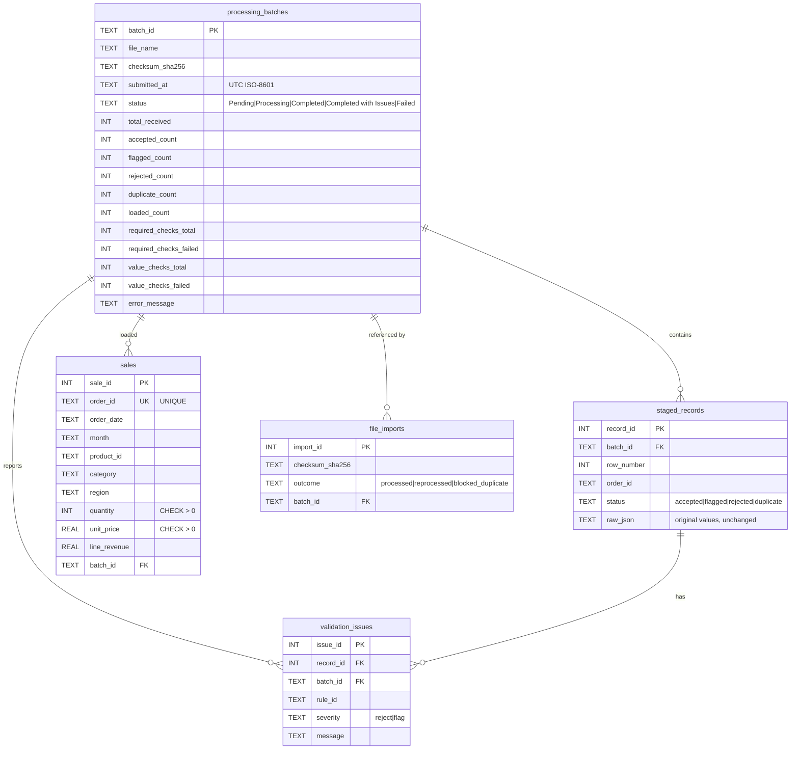

# Enterprise Data Pipeline & Quality Monitoring System

A local, end-to-end data pipeline that ingests sales CSV files, validates and explains every problem it finds, loads only trustworthy records into a relational database, tracks each import as an auditable batch, prevents duplicate loads, and monitors data quality across batches. Business analytics and data-quality monitoring live in the same system, so every revenue figure can be traced back to the quality of the data behind it.

> All data in this repository is synthetic. No real customer information is collected or stored.

---

## 1. Problem statement

Sales exports from operational systems are often messy: blank quantities, dates in the wrong format, negative prices, the same order exported twice, or categories nobody approved. If these reach a dashboard unchecked, revenue figures are wrong and nobody notices. This project answers two questions at once:

1. **What is happening in the business?** (revenue, orders, units, trends, regions, products)
2. **How reliable is the data behind those numbers?** (pass rates, rejection rates, duplicates, alerts)

## 2. Motivation and relevance

Data engineering teams spend much of their time on ingestion, validation and reconciliation. This project demonstrates the practices that matter in that work:

- **Explainable validation.** Every rejection carries a stable rule ID, a severity, a human-readable message and the original record.
- **Idempotent loading.** Re-running an import never double-counts sales.
- **Transactional loads.** A batch is either fully committed or fully rolled back, and the audit trail records the failure.
- **Deterministic monitoring.** Alerts come from explicit thresholds, not from opaque models.
- **Tested behaviour.** The pipeline, rules, metrics and SQL analytics all have automated tests.

## 3. Main features

| Area | What it does |
|---|---|
| Ingestion | Accepts CSV uploads or a bundled sample. Checks file type, size, encoding, structure and required columns. Skips malformed lines and counts them. |
| Validation | 17 stable rules (`VR-001`…`VR-017`) classed as **reject** or **flag**. Multiple issues per record are all reported. |
| ETL | Extract → transform (standardise, parse, derive `line_revenue`) → load in one transaction per batch. |
| Batch tracking | Every import has a unique batch ID, timings, counts, status and error message. History is never overwritten. |
| Duplicate protection | File-level SHA-256 checksum blocks accidental reprocessing. Record-level `UNIQUE` constraint on `sales.order_id` plus pre-checks. |
| Quality scorecard | Pass rate, rejected rate, duplicate rate, missing-value rate, invalid-value rate, processing time. Each rate documents its denominator. |
| Monitoring | Configurable threshold alerts with actual value, threshold, batch, explanation and recommended action. Batch-to-batch comparison and trend charts. |
| Analytics | SQL over accepted sales only: KPIs, monthly revenue, MoM and YoY growth, regional share, category and top-product analysis, filters. |
| Dashboard | Streamlit app with five pages: Overview, Upload & Process, Data Quality, Batch History, Sales Analytics. Plotly charts. |

## 4. Technology stack

- Python 3.10+ (tested on 3.12)
- pandas 2.2.3 for CSV parsing and tabular work
- SQLite (standard library `sqlite3`) for storage, with constraints, foreign keys, indexes and window functions
- Streamlit 1.40.2 for the dashboard
- Plotly 5.24.1 for charts
- pytest 8.3.3 for tests
- Git / GitHub for version control

No Docker, cloud services, API keys or machine-learning models are required.

## 5. System architecture

```
          ┌────────────────────────────────────────────┐
          │      Streamlit dashboard (app.py)          │
          │  Overview · Upload · Quality · History ·   │
          │  Analytics            (dashboard/*.py)     │
          └───────────────┬────────────────────────────┘
                          │ calls
          ┌───────────────▼────────────────────────────┐
          │              src/ (business logic)         │
          │                                            │
          │  ingestion ─► validation ─► transformation │
          │       │           │              │         │
          │       └──────── pipeline ◄───────┘         │
          │                   │                        │
          │  metrics · monitoring · analytics          │
          │                   │                        │
          │               database (SQLite)            │
          └────────────────────────────────────────────┘
```

Dependencies flow downward: the dashboard calls `src/`, and `pipeline` orchestrates the other modules. The same code paths are used by the dashboard and the tests, so the tests exercise the real pipeline. See `docs/architecture.md` for module responsibilities.

## 6. Data flow

1. **Extract.** The uploaded bytes are checked (extension, non-empty, size limit, UTF-8). A SHA-256 checksum is calculated. Column names are standardised (`Order Date` → `order_date`) and the header is checked against the required columns.
2. **Duplicate-file check.** If a batch with the same checksum already completed successfully, the attempt is logged in `file_imports` as `blocked_duplicate` and nothing is loaded. The user may tick *Reprocess*.
3. **Batch created.** A `processing_batches` row with status `Processing` is committed before any data is loaded. A crash therefore leaves a visible trace.
4. **Transform and validate.** Each row goes through the rule catalogue. A record's status is the most serious of: `duplicate` > `rejected` > `flagged` > `accepted`.
5. **Load (one transaction).** Every row is written to `staged_records` (so rejected and flagged records are preserved with their original values), every failed rule to `validation_issues`, accepted rows to `sales`, and final counts and status to `processing_batches`. Any exception rolls back the whole transaction. The batch is then marked `Failed` with a safe message.
6. **Monitor.** Metrics are derived from stored counts, alerts are evaluated against `ALERT_RULES`, and dashboards query the results.

## 7. Database schema



**Constraints and indexes.** Primary keys on every table. `sales.order_id` is `UNIQUE`. `quantity > 0` and `unit_price > 0` are `CHECK` constraints. Status and severity columns use `CHECK ... IN (...)`. Foreign keys are enforced (`PRAGMA foreign_keys = ON`). Indexes cover checksum lookup, issue lookup by batch and rule, and sales date, region and category.

**Timezone convention.** All timestamps are stored in UTC as ISO-8601 strings with an explicit offset (`2026-10-16T07:29:13+00:00`). The dashboard labels them "UTC". Converting to local time is a display concern.

**Schema management.** `src/database.py` holds the schema as idempotent `CREATE ... IF NOT EXISTS` statements, applied on each start-up. Introducing a breaking change would require a migration script; this is noted under limitations.

## 8. Validation rules

Severity **reject** means the record cannot be used for business calculations. Severity **flag** means the record is kept for review and is excluded from sales analytics by default (`LOAD_FLAGGED_RECORDS = False` in `src/config.py`).

| Rule | Category | Severity | Trigger |
|---|---|---|---|
| VR-001 | Missing value | reject | A mandatory field (order_id, order_date, product_id, category, region, quantity, unit_price) is blank |
| VR-002 | Invalid identifier | reject | order_id does not match `ORD-<number>` |
| VR-003 | Duplicate | reject | order_id already appeared earlier in the same file (first occurrence kept) |
| VR-004 | Invalid value | reject | order_date is not a real date in `YYYY-MM-DD` |
| VR-005 | Business rule | reject | order_date is after the processing date |
| VR-006 | Invalid value | reject | quantity is not numeric or is fractional |
| VR-007 | Business rule | reject | quantity ≤ 0 |
| VR-008 | Invalid value | reject | unit_price is not a finite number |
| VR-009 | Business rule | reject | unit_price ≤ 0 |
| VR-010 | Unexpected value | flag | category not in the approved list |
| VR-011 | Unexpected value | flag | region not in the approved list |
| VR-012 | Missing value | flag | customer_id blank (optional field) |
| VR-013 | Invalid identifier | flag | customer_id does not match `CUST-<number>` |
| VR-014 | Missing value | flag | product_name blank (optional field) |
| VR-015 | Invalid identifier | flag | product_id does not match `PRD-###` |
| VR-016 | Business rule | flag | quantity > 500 (unusually large, please confirm) |
| VR-017 | Duplicate | reject | order_id already exists in the sales table from an earlier batch (existing record kept) |

Example messages shown to users:

- `Order 100649 ... Quantity must be greater than zero (got -3)`
- `Required field 'order_date' is missing`
- `Duplicate order ID 'ORD-100095' appears earlier in this file`
- `Unit price must be positive (got 0)`

All thresholds and allowed values are in `src/config.py`.

## 9. Data-quality metrics

Record-level and field-level rates are kept separate. Each rate has an explicit denominator, and a zero denominator returns `None`, which the dashboard shows as *Not available*.

| Metric | Formula |
|---|---|
| Validation pass rate | (accepted + flagged) ÷ records received × 100 |
| Rejected-record rate | rejected ÷ records received × 100 |
| Duplicate rate | duplicates ÷ records received × 100 |
| Missing-value rate | failed required-field checks ÷ required-field checks performed × 100 (one check per mandatory field per row) |
| Invalid-value rate | failed format/type checks ÷ format/type checks performed × 100 (checks run only on populated fields) |
| Processing duration | `finished_at − started_at`, in seconds |

Because each record has exactly one status, the validation pass rate, rejected rate and duplicate rate add up to 100%. Flagged records count as passing the mandatory rules.

## 10. Business analytics definitions

- **Revenue** = sum of `line_revenue`, where `line_revenue = quantity × unit_price`.
- **Orders** = number of accepted sales rows (one row per unique `order_id`).
- **Units** = sum of `quantity`.
- **Average order value** = revenue ÷ orders.
- **MoM growth** = change against the previous recorded month.
- **YoY growth** = change against the same month last year (blank if that month has no data).
- **Regional share** = region revenue ÷ total revenue in the current filter.

All analytics read only the `sales` table. Rejected, duplicate and held-for-review records never reach it.

## 11. Installation and setup

Requirements: Python 3.10 or newer, and Git.

```bash
# 1. Clone the repository
git clone https://github.com/<your-username>/enterprise-data-quality-monitor.git
cd enterprise-data-quality-monitor

# 2. Create and activate a virtual environment
python -m venv .venv
# macOS / Linux:
source .venv/bin/activate
# Windows (PowerShell):
.venv\Scripts\Activate.ps1

# 3. Install pinned dependencies
pip install -r requirements.txt

# 4. Generate the synthetic sample datasets (already included, but reproducible)
python scripts/generate_sample_data.py
```

## 12. Running the application

```bash
streamlit run app.py
```

The browser opens at `http://localhost:8501`. The SQLite database is created automatically at `data/sales_monitor.db`. To use a different location:

```bash
# macOS / Linux
SALES_DB_PATH=/tmp/demo.db streamlit run app.py
# Windows (PowerShell)
$env:SALES_DB_PATH="C:\temp\demo.db"; streamlit run app.py
```

Other settings (in `src/config.py` or environment variables): `MAX_UPLOAD_MB` (default 5), `LOG_LEVEL` (default INFO).

## 13. Running the tests

```bash
pytest -v
```

The suite (60 tests) uses a temporary SQLite database for each test and never touches `data/sales_monitor.db`. Tests cover ingestion, validation rules, transactions and constraints, the ETL pipeline (including duplicate files, forced reprocessing, partial overlap and rollback), metrics, alerts, comparisons and SQL analytics.

**Result of the last run:** `60 passed`. Run the command yourself to confirm on your machine.

## 14. Demonstration walkthrough

1. **Overview.** The database is empty, so the page shows guidance.
2. **Upload & Process → Use a sample dataset → "Clean sample" → Validate & process.** Expect *Completed*, with 600 records received and 600 loaded.
3. **Upload & Process → "Sample with deliberate errors" → Validate & process.** Expect *Completed with Issues*. The batch summary shows 240 received, 217 accepted, 7 flagged, 14 rejected, 2 duplicates, and 1 malformed line skipped.
4. **Data Quality.** Select the dirty batch. Review the scorecard, the error breakdown by rule, the filterable issue table, and download the error report.
5. **Upload & Process → "Clean sample" again.** It is blocked as a duplicate file and nothing is loaded. Tick *Reprocess* and run it again: every row becomes a duplicate and sales totals stay the same.
6. **Upload & Process → "Clean sample" with the dirty file already loaded.** The clean file reports 1 duplicate, because the dirty file loaded `ORD-100011` first. This cross-file overlap is planted on purpose.
7. **Upload & Process → upload `data/sample_sales_high_error.csv`.** About 25% of its records are rejected, which triggers two alerts: rejected rate above 10% and pass rate below 90%. Each alert shows its actual value, threshold, batch and recommended action.
8. **Batch History.** Compare two batches and review the trend charts.
9. **Sales Analytics.** Filter by date range and region. Note that the figures come only from accepted records.

Sample files in `data/`:

| File | Records | Purpose |
|---|---|---|
| `sample_sales.csv` | 600 | Clean, realistic data with seasonal patterns (higher volumes in Nov–Dec) |
| `sample_sales_with_errors.csv` | 240 | One example of each validation problem, plus one malformed line |
| `sample_sales_high_error.csv` | 80 | About 25% rejected, to trigger the rejected-rate alert |

## 15. Example outputs

Results from one local run of the bundled samples, shown to illustrate the output format. Your numbers will match if you run the same files in the same order.

| Batch | Received | Accepted | Flagged | Rejected | Duplicates | Pass rate | Rejected rate |
|---|---|---|---|---|---|---|---|
| sample_sales_with_errors.csv | 240 | 217 | 7 | 14 | 2 | 93.33% | 5.83% |
| sample_sales.csv (after the dirty file) | 600 | 599 | 0 | 0 | 1 | 99.83% | 0.00% |
| sample_sales_high_error.csv | 80 | 60 | 0 | 20 | 0 | 75.00% | 25.00% |

Missing-value and invalid-value rates are also computed for each batch and shown on the Data Quality page.

## 16. Screenshots

Screenshots are not included in this repository. To add them after running the app, save images to `docs/screenshots/` and reference them here, for example:

```markdown


```

## 17. Project structure

```
enterprise-data-quality-monitor/
├── app.py                      Streamlit entry point and navigation
├── dashboard/                  One module per dashboard page
│   ├── overview.py  upload.py  data_quality.py  batch_history.py  analytics.py  common.py
├── src/                        Business logic (no Streamlit imports)
│   ├── config.py               Validation policy, thresholds, paths
│   ├── logging_config.py
│   ├── ingestion.py            Extract: file checks, checksum, CSV parsing
│   ├── transformation.py       Column standardisation, derived fields
│   ├── validation.py           Rule catalogue and record-level validation
│   ├── database.py             Schema, connections, transactions, queries
│   ├── pipeline.py             ETL orchestration and batch lifecycle
│   ├── metrics.py              Data-quality rate definitions
│   ├── monitoring.py           Alerts, comparisons, trend data
│   └── analytics.py            SQL business analytics
├── scripts/generate_sample_data.py
├── data/                       Synthetic CSV samples (the generated .db is git-ignored)
├── tests/                      pytest suite
├── docs/architecture.md
├── requirements.txt  pytest.ini  .gitignore  README.md
```

## 18. Security and responsible handling

- Uploads are limited by extension, size (5 MB by default) and encoding. Uploaded content is parsed as data and never executed.
- All SQL that accepts user-controlled values (dates, region, limits) uses `?` parameters. The only string-built SQL uses fixed column names defined in code.
- Users see short, safe messages. Stack traces and internal errors go to the log.
- The sample data is synthetic. Customer IDs are placeholders.
- `.gitignore` excludes the database, secrets, virtual environments and caches.

## 19. Known limitations

- **Single-user, local demo.** SQLite allows one writer at a time and there is no authentication. It is not designed for multi-user production use.
- **Row-by-row validation in Python.** This is clear and easy to test, but it will be slower than vectorised pandas on very large files (millions of rows). The 5 MB upload limit keeps this manageable.
- **Overlap policy is "keep existing".** If a later file corrects an order that is already loaded, the correction is reported as a duplicate and is not applied. An explicit update policy would be needed for corrections.
- **No schema migrations.** The schema is created with `IF NOT EXISTS`. Changing a table later would require a migration tool such as Alembic or a version table.
- **Simple statistics only.** Alerts use fixed thresholds, not statistical baselines.
- **Currency is not modelled.** Revenue is a plain number with no currency code.
- **Flagged records need a review step.** They are held out of sales by default. The app shows them but does not provide an approve-and-load action.
- **The ORD/PRD/CUST formats are assumptions** taken from the sample data. Real systems would need these patterns configured.

## 20. Future enhancements

- An approve/reject workflow for flagged records, with reviewer notes stored in the database.
- An explicit correction policy, with versioned sales rows and an audit log of changes.
- Schema migrations with Alembic, and PostgreSQL support through SQLAlchemy.
- Scheduled ingestion from a watched folder.
- Statistical anomaly detection (for example, z-scores on daily revenue) as an optional, explained alert type.
- Role-based access and authentication before any shared deployment.
- Containerised deployment, with tests running in CI on every pull request.

## 21. Publishing to GitHub

```bash
# From the project folder, after confirming that the tests pass
git init
git add .
git status            # check that no .db, .venv or __pycache__ files are staged
git commit -m "Initial commit: enterprise data pipeline and quality monitor"

# Create an empty repository named enterprise-data-quality-monitor on github.com (no README/licence there),
# then connect and push:
git branch -M main
git remote add origin https://github.com/<your-username>/enterprise-data-quality-monitor.git
git push -u origin main
```

Before publishing, check that `data/sales_monitor.db` is not present. It is ignored by `.gitignore`, but verify it. Add a licence file if you want others to reuse the code.

## 22. Relevance to enterprise data engineering

This project covers practices that appear in production data platforms: staged ingestion, rule-based validation with explainable failures, idempotent loads, transactional writes with rollback, audit trails, data-quality KPIs and threshold alerts, and analytics built only on validated data. Swapping SQLite for a warehouse, the file upload for a scheduled job, and the Streamlit pages for a BI tool would not change the core design.

## Licence

Add a licence file before public reuse.
